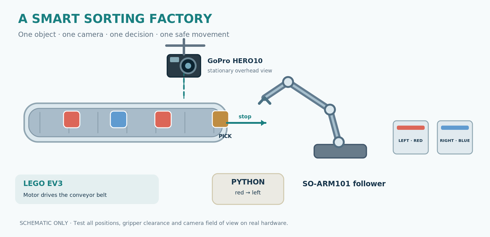

# CPS Candy Factory | Exciting Science 2026

**T17(1) — Autonome Robotersteuerungen in Python programmieren**
Montanuniversität Leoben · Cyber Physical Systems · 4 hours · 6 first-semester students · DE/EN

> **Start here:** `python -m workshop` works offline on a low-cost CPU laptop with Python 3.11+. No GPU, arm, camera or EV3 required.



*Editable SVG-based schematic, not a photograph or a validated laboratory installation.*

[**Browse the visual gallery**](docs/visual-gallery.md) · [Image credits and regeneration](docs/assets/README.md)

## Student quick start

```bash
python -m venv .venv
source .venv/bin/activate  # Windows: .venv\\Scripts\\activate
python -m workshop
python exercises/01_python.py
python exercises/02_robot.py
python exercises/03_vision.py
python exercises/04_sort.py
```

For a USB webcam only (no physical actuators):

```bash
pip install -e '.[camera]'
python tools/camera_probe.py 0
python -m workshop --camera 0 --cycles 3
```

This intentionally keeps **robot and conveyor simulated** even with a real camera. Use the physical equipment only through instructor-supervised, validated procedures.

## Learning path

1. Understand *sensor → decision → action → feedback*.
2. Teach the SO-ARM101 using the official LeRobot leader–follower demo (instructor supervised).
3. Discover object colors through an overhead camera, or use simulation.
4. Change `if` / classification rules to route objects left or right.
5. Demonstrate an automated cycle and discuss safety and errors.

## What exists and what does not

| Subsystem | Implemented | Validated | Status |
|---|---|---|---|
| Offline simulator and CPS decision logic | Yes | Automated tests | READY |
| CPU HSV red/blue detection | Yes | Synthetic tests | READY for laptop trial |
| Generic USB/UVC camera capture | Yes | No physical camera test | BENCH TEST NEEDED |
| GoPro HERO10 via official Open GoPro | Official SDK walkthrough | Not connected here | BENCH TEST NEEDED |
| EV3 motor via ev3dev2/ RPyC | Instructor-only *probe* | No physical motor test | BENCH TEST NEEDED |
| LeRobot leader-follower | Official commands documented | No arm attached | BENCH TEST NEEDED |
| Autonomous physical pick-and-place | Not implemented | None | **TODO / DO NOT ENABLE** |
| Neural detector (YOLO-World, Jetson) | Not installed | None | OPTIONAL / DEFERRED |

Never advertise the physical sorting station as working before completing `docs/acceptance.md`.

## Documentation

- [Four-hour teaching plan](docs/lesson-plan.md)
- [Student worksheet](docs/student-worksheet.md)
- [Instructor setup and safety](docs/instructor.md)
- [HERO10 / UVC camera decision guide](docs/cameras.md)
- [Hardware acceptance criteria and unfinished tasks](docs/acceptance.md)
- [References and licenses](docs/references.md)
- [Printable DOCX and presentation generators](tools/build_materials.py)
- [Visual gallery — diagrams and illustrative scene images](docs/visual-gallery.md)

## Prepare workshop handouts

```bash
pip install -e '.[materials]'
python tools/build_materials.py
```

Produces `docs/instructor-guide.docx`, `docs/student-worksheet.docx`, and `docs/workshop-slides.pptx`. Use slide deck on a projector and one worksheet per team. A GitHub Actions workflow checks tests and builds printable material.

## Dependencies / platform

Python 3.11–3.13 recommended. Main simulator: standard library only; optional OpenCV and numpy for CPU vision. **No CUDA, PyTorch, ROS 2, Docker, or GPU required.** An NVIDIA Jetson Thor is an optional instructor demonstration machine, never a student dependency.

## Design rules

- One stopped object at a time; fixed pickup guide; big flat objects, not loose M&M's.
- Students change short, visible Python programs; no installation or troubleshooting during their rotation.
- Errors or unknown colors route to `reject`; missing frames stop the belt.
- Real robot movement only after supervised calibration, reach/trajectory checks and explicit opt-in.

## Visual design and QA

The slide deck and handouts intentionally use **one consistent vector schematic style** from `tools/make_assets.py`. Text and code are editable PowerPoint/Word content. Earlier AI concept photo crops are retained only for reference in `docs/assets/archive/` and `docs/assets/sources/` and are **not used in classroom material** because they inconsistently represent the hardware. See [`docs/revision-report.md`](docs/revision-report.md).
