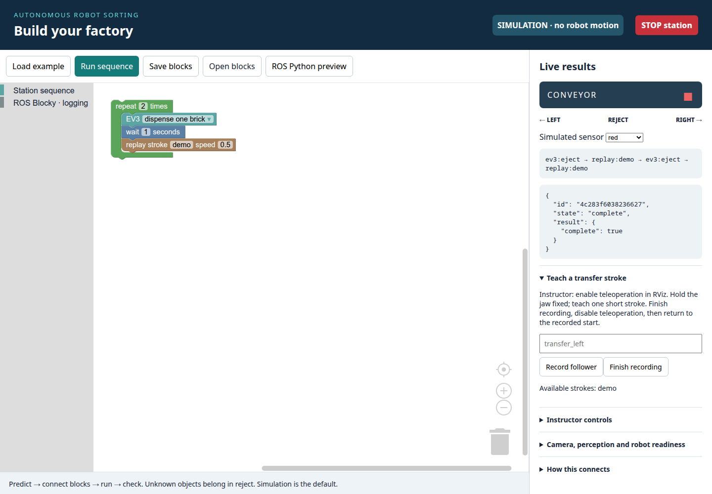

# Build your factory with blocks

**35-minute pair challenge.** A block is an instruction. Connected blocks run
in order; a repeat block runs its instructions more than once.

## Open your factory

Keep the extracted workshop folder together. Run:

```bash
python3 tools/run_blockly_station.py
```

On Windows use `python` instead of `python3`. Open **http://127.0.0.1:8877**.
The heading says **SIMULATION — no robot motion**. No internet or extra packages
are needed. Keep the terminal open; Ctrl+C closes the simulator.



## Predict, build, run, check

1. **0–5 minutes:** Look at the example. Which instructions run twice?
   Predict the action list, then click **Run sequence** and compare.
2. **5–12 minutes:** Change the repeat count. Add a conveyor movement before
   dispensing. Make one change at a time. Swap who uses the mouse.
3. **12–22 minutes:** Add a color decision. Use the **Simulated sensor** menu
   to try red and blue. Make each choose a different transfer stroke or
   conveyor destination. The supplied `demo` stroke represents an invented
   robot movement.
4. **22–30 minutes:** Try **unknown**. In that branch, log a message such as
   “Unknown object: reject” and skip dispensing and gripping. Explain why
   choosing red or blue without a measurement would be wrong.
5. **30–35 minutes:** Save your blocks. Show another pair your prediction,
   observed action list and one corrected mistake.

| Experiment | Prediction | What happened? |
| --- | --- | --- |
| Changed repeat count | | |
| Unknown sensor reading | | |

## At the real robot station

The instructor opens a separate live version. You can teach a short movement
with the leader arm, record the follower, then use a replay block. Hold the jaw
at one opening during each recording; use separate calibrated grip/release
instructions. A replay starts at the recorded starting pose. The instructor
checks the path and returns the arm there before replay.

**Explain your system:** What observes the object? Which block decides?
What moves? What tells you the movement finished?
