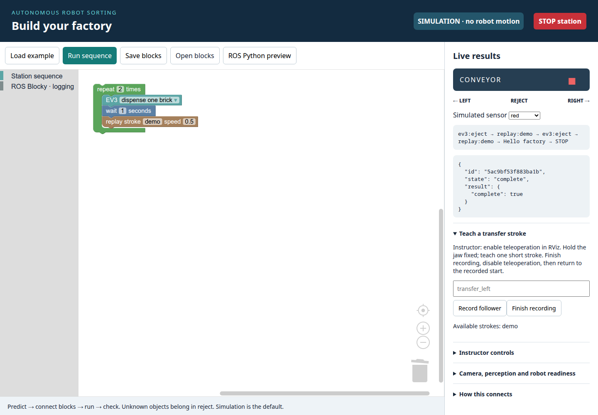

# Blockly station lab — interface and operating boundaries

## Design

An offline Blockly 10.4.3 editor produces a strict, bounded JSON program. A
loopback-only Python server executes it in simulation by default. Explicit
`--physical` enables an adapter to the existing ROS action/service interfaces;
there is no serial driver, arbitrary code execution or ROS topic publishing.
One program runs at a time. Cancellation, deadlines and any failure request
station STOP; an uncertain service/action delivery is never automatically retried.

[ROS Blocky upstream](https://github.com/ros-blocky/ros-blocky), pinned at
`a34adbdef1c4b92374d2880a755e53436ca24754`, targets Windows and lists Linux support
and service/action clients on its roadmap. This Linux station extension ports
its two logging blocks and Python generators with compatible block IDs and
inputs. It saves its own Blockly workspace JSON; upstream XML `.nodeblocks`
files are not interchangeable. Station automation blocks use the existing ROS 2
gateway. This is not the unmodified ROS Blocky desktop application.

## Canonical beginner lesson

The four-hour schedule, eight missions, worked examples and success criteria come
from [curriculum/workshop.json](../curriculum/workshop.json). Use the generated
[lesson plan](lesson-plan.md), [practical activity cards](activity-cards.md),
[student worksheet](student-worksheet.md) and [student Blockly guide](blockly-student.md).
The browser consumes the same generated mission projection and exposes categories
progressively. Maintenance blocks, recovery controls and legacy starters belong
to the instructor drawer. Loading a mission never runs it.

Pairs predict, change one value, run, observe and explain. Simulation has explicit
synthetic conveyor/brick/jaw state; command logs, jaw closure and ordinary replay
do not establish physical grasp or placement. The final supervised integration
combines the commissioned EV3 conveyor with a named taught pick/place skill for
one fixed pickup fixture and one fixed drop. That named transaction is
implemented but **no commissioned physical skill is supplied**; use the offline
route until its [qualification gates](taught-pick-place.md) pass.

A recording is not a qualified plan. Replay retains the bridge's collision and
sample-hash checks and may reject a demonstrated path. It starts at the recorded
pose. A separate explicit `approach_recording` block can plan to that start; replay itself never inserts an approach. Record separate strokes with a
constant jaw; changing jaw during recording rejects that recording. Replay speed
is 0.1–1.0, default 0.5; the bridge remains authoritative for all motion limits.

## Start

Simulation needs only standard Python; all browser assets are committed:

```bash
python tools/run_blockly_station.py
# Open http://127.0.0.1:8877
```

Start the existing full station first for a physical session, then in a separate
terminal use the same ROS environment/domain as that station:

```bash
ros2/conda/so101-conda.sh run python tools/run_blockly_station.py --physical --instructor --port 8897
# Open http://127.0.0.1:8897; reuse it if the live editor is already running.
```

The server binds only loopback. Simulation uses ports 8877/8878; the physical
command above uses 8897/8898 so both editors can stay open. The second port in
each pair is a separate STOP-only listener with its own bounded request pool.
Keep both ports free before starting an editor. The editor's STOP
button uses that listener even when ordinary API requests are occupied. A random
in-memory token and exact host/origin checks protect requests; no token is saved
in the repository. This is a local instructor workstation application, not a
multi-user remote-control server.

Physical mode requires the station API STOP response with a `request_id`
(introduced in commit `2a6572a`). Older APIs fail STOP verification explicitly.
The application never starts a second hardware owner, enables torque at startup,
changes firmware limits or connects USB devices directly. Instructor mode
exposes the existing operator services; those services retain their own admission
checks. Closing physical mode requests a verified station STOP.

### Starter workspaces

Use **Starter → Load starter** in the editor; **Download starter** saves a JSON
copy for **Open blocks**. Save an edited workspace before loading another.

1. **EV3 endpoints:** connect, home, left end, right end. Predict and change the
   order in simulation before using the commissioned conveyor.
2. **Teach and replay:** record the placeholder `my_short_move`, then replay at
   speed 0.5. In simulation only, deliberately replace its name with `demo`.
3. **Color factory:** connect, repeat, route red/blue through dispensing and the
   corresponding conveyor endpoint; unknown logs and stops before manipulation.
   Its physical use requires a fresh color measurement and a commissioned feeder.
4. **SO-ARM101 teach a stroke:** try in simulation first. The program logs guidance,
   selects relative leader teleoperation, captures `my_short_move` for 5 seconds,
   returns to MoveIt and logs the next step. In physical mode an instructor must
   supervise mode switching; hold the jaw fixed and move the leader during the
   capture window. Choose a unique name. Load starter 2 for a separate replay run
   after the instructor returns the follower to the recorded start.

5. **Reset and reinitialize:** a flat **Restart entire station + verify** block,
   followed by a message. It uses existing station recovery, then verifies the
   result. Save the current workspace before loading this starter. After success,
   use a separate run for arm modes or motion. Restart does not enable torque or
   approach a saved pose automatically.

Both editor modes load the canonical selected mission. Its toolbox exposes only
the current learning categories; instructor maintenance categories are opt-in
inside the drawer. The five legacy starters remain instructor utilities.
Loading a starter never runs it; physical backend admission remains mandatory.


### Recording and replay

1. Enable the desired teleoperation mode under supervision using the SO-ARM101
   block or RViz. Physical arm mode commands require `--instructor`.
2. Set the jaw, hold it fixed and choose a new stroke name such as `lift_closed`.
3. Use **record follower stroke** for a finite **1–30 seconds**, or press
   **Record follower**, demonstrate a short path, then **Finish recording**.
   Timed capture is read-only and reuses the existing fixed-jaw, pinned-owner
   collector; it sends no joint targets or force commands. A canceled or stale
   capture saves no partial recording. Simulation recordings are memory-only.
   Physical names must be new: no overwrite, repeated record block, or recording
   under any nested repeat whose expanded execution count exceeds one.
4. Disable teleoperation in RViz. Return the follower to the recorded starting
   pose under supervision, or use a separate explicit approach block with current
   MoveIt/scene admission. Replay never makes this approach automatically.
5. Enter that name in a replay block, initially at speed 0.5. Capture and replay
   use separate programs and separate **Run sequence** actions; do not combine
   recording and playback in one program.
6. Separate jaw blocks use the measured gap in millimetres and require qualified
   metric SI gap calibration. MoveIt gripper Plan & Execute additionally requires
   joint-angle calibration. The status reports separate flags; a false combined
   MoveIt-ready flag does not disable a valid SI interface. Qualification may
   cover a restricted working interval; a full-range calibration is not required.
   The currently recorded single 9 mm point does not qualify an interval.

Recordings contain five measured arm angles plus the fixed jaw angle and a
pinned arm/calibration/owner-generation/source identity, including the resident
loaded jaw-gap and joint-angle calibration hashes. Physical teaching and replay
require both qualified calibrations; older strokes missing either hash require
reteaching. After an
owner restart/reconnect they require live durable-binding revalidation; a new
owner generation alone does not certify or invalidate durable calibration.
Changed robot/calibration/source provenance requires reteaching or explicit
revalidation. See [recording restart behavior](python-station-client.md#recording-restart-behavior). The
JointState header is a bridge publication timestamp, not a motor acquisition
timestamp: the collector also requires a fresh, identity-matched owner snapshot.
Any >300 ms gap, regressing timestamp, changing jaw or cohort change rejects the
recording. No incomplete recording is saved.

Up to 64 recordings, 600 samples and 60 seconds per recording are retained under
`~/.local/share/exciting-science/blockly-recordings/`. Archive older files while
the server is stopped. Files are never overwritten silently.

A complete detected-object dispense/pick/place program additionally needs the
scene ownership transaction. Taught-stroke and jaw-position blocks do **not** implement target
locking, bounded finger-contact allowance, contact inference, attach/lift
verification or detach/release ownership. The jaw-gap block requires a reached
position and rejects inferred contact; it is not a grasp-contact block. A detected
world brick can therefore make jaw closing or lifting fail collision preflight.
Do not remove the brick from the scene or publish arbitrary attachment messages
to bypass that check. Use the separate **Run one commissioned sorting cycle** block for the native
object transaction described below; it requires an already commissioned station. Free-space taught motion and
EV3 sequencing are the currently exposed physical activities. These capabilities do not establish that a
physical autonomous sorting cycle has passed. The instructor must qualify the
exact strokes, object, jaw gap and environment before students run that cycle.

### Historical free-stroke teaching sketch (not physical acceptance)

Prepare and qualify the strokes before the class. Names below are suggestions,
not supplied recordings. Each stroke's fixed jaw opening must match the preceding
jaw instruction, and its first arm pose must match the preceding stroke's end.

```text
Connect EV3
Repeat 2 times:
  Dispense one brick
  Conveyor right end (the commissioned pickup side)
  If sensor is red:
    Open jaw to the measured release gap
    Replay approach_open
    Close jaw to the measured grasp gap
    Replay lift_closed
    Replay place_left_closed
    Open jaw to the measured release gap
    Replay return_left_open
  Else if sensor is blue:
    Open jaw to the measured release gap
    Replay approach_open
    Close jaw to the measured grasp gap
    Replay lift_closed
    Replay place_right_closed
    Open jaw to the measured release gap
    Replay return_right_open
  Else: log "Unknown: ask the instructor" and STOP
```

For a real cycle, check unknown color **before dispensing or grasping** whenever
the sensor can already observe the object. If color becomes available only at
pickup, branch there before closing the jaw. The sketch's final return must be
inside each color branch so that the correct return stroke is selected. Test
each branch separately in simulation; do not assume a left return starts at the
right destination. Follow the canonical missions for the beginner task. This
older free-stroke sketch does not implement contact, lift or release verification;
physical integration uses the commissioned [named transaction](taught-pick-place.md).

Keep demonstrations short and move continuously. Recorded pauses and encoder
variation remain in the stroke; the bridge may lengthen it to satisfy its motion
limits. The replay speed is a request, not a guaranteed execution duration.

## Exposed interfaces

| Blockly function | Existing ROS interface | Completion |
| --- | --- | --- |
| Station reset / reinitialize / services | Existing `/station/operator/{command}` and explicit recovery verification | Instructor required; exact acknowledged result; no arbitrary endpoint |
| Arm commands | Existing guarded operator services; saved-home action; verified station STOP | Physical instructor required; exact completion/STOP checks |
| Follower recording | `/follower/joint_states`, `/follower/status` | Read only; fresh pinned cohort |
| Replay stroke | `/follower/arm_trajectory_controller/follow_joint_trajectory` (`FollowJointTrajectory`) | Accepted goal **and** terminal successful result, error code 0 |
| Jaw gap | `/follower/gripper_controller/gripper_cmd` (`GripperCommand`, metres) | Qualified calibration; reached goal and not stalled |
| Jaw readiness | `/follower/gripper_calibration_status` (`Trigger`) | Structured calibrated status |
| One complete sorting cycle | `/station/run_cycles` (`so101_station_workflow/srv/RunCycles`, `cycles=1`) | Exact workflow job and verified one-object result; commissioning required |
| EV3 connect/home/left/right/eject | `/station/ev3/connect`, `/home`, `/left_end`, `/right_end`, `/eject` under `/station/ev3` | Exact workflow `job_id` reaches idle with result; faults reject |
| EV3 wake/sleep | `/station/wake`, `/station/sleep` (`Trigger`) | Acknowledged guarded service, workflow terminal where supplied |
| Color condition | `/station/ev3/operator_status` | Fresh connected native EV3 S3 color; unknown is explicit |
| Camera/perception readiness | `/station/operator/status` | Read-only status viewer; no fabricated camera image |
| Teleoperation readiness | `/follower/teleop_status` | Read-only status viewer |
| STOP | `/station/stop`, `/station/status` plus active action cancellation | Exact returned STOP request ID, EV3 stopped and arm disarmed |
| Instructor controls | `/station/operator/{command}` (`Trigger`) | Existing station response; no arbitrary service names |

The strict arm opcode is `{"op":"arm","command":"home"}`. Its only command
values are `home`, `moveit`, `teleop_relative`, `teleop_absolute` and `torque_off`.
Home uses the existing saved-home motion; MoveIt uses the guarded MoveIt mode
service. Relative and absolute modes first select the corresponding existing
relative/absolute RPC, then enable teleop through the existing guarded service.
`torque_off` is labeled **torque OFF / station STOP**: it requests verified station
STOP, stopping EV3 as well as disarming the arm. No new controller or arbitrary
joint-target interface is introduced. All physical arm commands require instructor
mode and retain native admission and recovery gates.
Saved home requires leaving active teleoperation: connect a **MoveIt mode**
block before **Saved home**.

The **Station controls** block compiles to
`{"op":"station","command":"reinitialize"}`. Its dropdown exposes the existing
instructor allowlist below plus `reinitialize` and `verify_recovery`.
**Restart entire station + verify** invokes the existing emergency reset and then
verifies recovery; **Verify recovery / unlock** checks an already inspected and
recovered station. A failed verification keeps the Blockly recovery latch.
The individual restart controls cover MoveIt, camera, depth, tags and perception.
Physical station controls require instructor mode.

While recovery is latched, only a **flat** program containing at least one
recovery station command is admitted. Other instructions may only be log, wait or
STOP. Allowed station commands in that recovery program are `reinitialize`,
`verify_recovery`, `emergency_reset`, `reset`, `zero_torque`, `restart_moveit`,
`restart_camera`, `restart_depth`, `restart_tags`, `restart_all`, `verify_restart`.
No loops, color branches, recording, replay, jaw, arm motion or mode changes can
be appended to that rescue run. Only confirmed `reinitialize`/`verify_recovery`
clears the Blockly latch; perform mode changes or motion in a separate run.
The Run button remains available for rescue programs, with normal backend
admission enforced. STOP retains its independent listener.

**SO-ARM101** relative/absolute teleop blocks select a mapping and then enable
teleoperation. **Station controls** exposes the lower-level mapping selector and
teleop enable separately; selecting a mapping alone does not enable following.

Instructor allowlist: `emergency_reset`, `reset`, `start`, `base_release`,
`base_confirm`, `teleop`, `teleop_relative`, `teleop_absolute`, `moveit`, `damping`,
`zero_torque`, `restart_moveit`, `restart_camera`, `restart_depth`, `restart_tags`,
`restart_all`, `verify_restart`. After an unknown/failed physical operation, motion
and mode changes stay blocked. Inspect/recover through the existing station
controls, then use **Verify recovery / unlock Blockly**. Unresolved mutating
requests and late action delivery prevent that unlock. No mutation is retried.
A verified, acknowledged **STOP** block ends the sequence with state `stopped`
and does not require recovery. Failed or unconfirmed STOP still requires recovery;
the editor displays the reported reason and blocks starting a recording.

The color condition currently uses the EV3 color sensor, not a guessed camera
object. Camera-based object identity/selection remains part of the existing
perception/sorting station; it is not silently substituted for a sensor block.

## Program protocol

`GET /api/status` returns `admission = {"session":"...","epoch":0}` plus
station/job state; `GET /api/recordings` lists recordings. Authenticated JSON POSTs:

- `/api/program/run`: `{"program":[...],"admission":{"session":"...","epoch":0}}` → exact job ID; poll status to terminal.
- `/api/program/stop`: `{}` → verified STOP or explicit missing acknowledgement; stamp is never required.
- `/api/record/start`: `{"name":"transfer","admission":{...}}`; `/api/record/stop`: `{"admission":{...}}`.
- `/api/instructor`: `{"command":"moveit","admission":{...}}`; `/api/recover`: `{"admission":{...}}`.
- `/api/simulation/color`: `{"color":"unknown","admission":{...}}`; simulation only.
- `/api/python`: `{"program":[...]}` → `{"python":"..."}` executable shared-client source; read-only.

Here `{...}` means the exact session/epoch object returned by status. The same
stamp is mandatory for ROS program/control mutations. STOP advances the epoch
before cancellation; process restart changes the session. An old queued command
cannot admit after STOP or restart. Each admitted operator/recovery request also
carries an application cancellation event combined with API shutdown through the
existing ROS delivery lock. A stale/uncertain mutation is never retried; inspect
and choose a new intentional operation after fresh status.

Commands are `station`, `arm`, `record_stroke`, `ev3`, `wait`, `approach_recording`,
`replay`, `pick_place_recording`, `sort_cycle`, `jaw`, `repeat`, `if_color`, `log`,
`stop`. Timed capture is exactly
`{"op":"record_stroke","name":"my_short_move","seconds":5}`: an existing-valid
recording name and a finite duration from 1 through 30 seconds. In physical mode
use a unique name, without repeated capture or a surrounding expanded repeat
count greater than one. Recording does not acquire detected-object ownership;
the native grasp, attachment, collision and full-cycle commissioning gates remain
required.
Programs reject unknown/extra fields, nonfinite numbers, duplicate JSON keys,
more than four nesting levels or 100 expanded steps. Repeat is 1–5, wait 0–10 s,
program deadline 180 s. HTTP bodies are limited to 256 KiB, request sockets to 2 s,
with eight worker slots per listener. Saved workspace JSON is editable Blockly
state. Exported Python calls the same validated-AST shared station service; the
web server interprets the AST and does not execute uploaded Python.

Before starting a sequence, every replay name is checked against the saved
recordings, including both sides of color decisions and nested repeats. A missing
stroke rejects the sequence before dispensing or any other command is sent.
The controller still checks identity, starting pose, jaw and collisions at replay.

## Rehearsal commands

```bash
python -m pytest tests/test_blockly_station.py -q
python tests/blockly_benchmark.py
# With the simulation server running; requires Playwright only on the test PC:
python tests/blockly_browser.py
# Isolated fake ROS only; never point this fixture at the physical station:
ROS_DOMAIN_ID=75 ROS_LOCALHOST_ONLY=1 ros2/conda/so101-conda.sh run python tests/blockly_fake_ros.py
```

The fake ROS rehearsal records a fixed-jaw stroke, replays it at half speed,
executes a metric jaw action and an EV3 job, rejects stale feedback and cancels an
active replay through correlated STOP. These are interface tests, not physical
acceptance. Real motion, camera tracking, dispenser reference and payload contact
must be qualified on the connected hardware separately.



### Historical software rehearsal evidence

- Focused tests cover program limits, strict JSON/auth/origin checks, fixed-jaw
  recording, source/cohort changes, stale/unknown responses, correlated STOP,
  cancellation failures, mandatory EV3 motion job IDs and explicit recovery.
- Headless Chromium: offline editor, drag a block, save/reopen workspace, ported
  ROS Blocky logging/the then-current Python preview, repeat sequence and actual STOP event passed
  with zero JavaScript exceptions. STOP's CORS preflight has one origin header.
- Isolated ROS domain 75: six captured samples, EV3 exact workflow completion,
  half-speed arm replay, metric jaw action, stale rejection and action cancellation
  passed. No physical devices were used by the fake station.
- Independent review measured accepted six-joint callbacks at 4.16 µs p95,
  sixteen-joint callbacks at 3.42 µs, a 32 KiB status message at 31.82 µs and
  100-command validation at 88.3 µs on this workstation. Saturating all eight
  ordinary HTTP workers left the separate STOP listener responsive at 0.81 ms.
  These are software timings, not robot tracking or remote-PC measurements.

Physical platform commissioning and a complete autonomous pick/place cycle remain
separate acceptance steps. In particular, a feeder reference, calibrated jaw gap,
valid demonstrated strokes and current collision scene are required.

### Classroom update, 22 October

The preflight, recording/replay, sorting-cycle and learner-bundle suites passed
73 tests. The isolated browser rehearsal passed starter download/import, red,
blue and unknown branches, saving/reopening, STOP, and non-actuating initial
workspaces for physical or unknown mode, with no JavaScript errors. An isolated
fake ROS station passed arm, jaw, EV3, exact cycle completion, stale-input rejection
and cancellation checks. These checks did not operate physical devices.

Missing replay names now reject a whole sequence before dispatch, including
names inside either conditional branch. The independent static guard prevents
backend calls or recording-payload reads in this check. On this workstation,
the largest accepted nested program took about 1.40 ms for validation plus
preflight, versus 1.29 ms for validation alone. No work was added to the robot
control or feedback tick. Reproduce the guard and measurement with:

```bash
python -m pytest tests/test_blockly_station.py tests/test_blockly_preflight_guard.py -q
python tests/blockly_preflight_benchmark.py
```

### Connected-station rehearsal, 21 October

The local station passed measured recording and physical replay through Blockly,
an EV3 connect → left-end → right-end program, correlated STOP on the separate
listener, and explicit recovery after a missing-stroke error. Recording captured
204 samples during two small supervised MoveIt moves; human leader movement was
not used in this rehearsal. The bridge retimed the 20.35-second recording at
speed 0.5 to 117.22 seconds. All six servos were measured torque off after STOP.
The [commissioning record](blockly-station-commissioning-2026-10-21.json) retains
the source identity, measured results and remaining acceptance steps. Dispensing,
metric jaw control and a full payload pick/place cycle were not commissioned.

## Optional replay timing: skip stationary pauses

**Original timing remains the default**, including for saved workspaces and JSON
programs that omit `timing`. Each replay block can explicitly select **Skip
stationary pauses**. JSON uses `"timing": "skip_stationary_pauses"`; the only
other accepted value is `"original"`.

This option removes only redundant samples in long runs whose five arm positions
are **exactly identical**. The first two and last two samples of every such run
are retained. Every nonzero position edge and its order are unchanged. There is
no filtering, relative offset, new approach movement or modification of saved
recordings. Short runs, turns and corners are retained. Timing of pauses changes;
put deliberate delays in Blockly **Wait** blocks instead.

A replay block displays the recording's original duration and the duration
requested by its timing option and speed. These are **before controller
retiming**, not promises of execution time or collision acceptance. Summaries are
computed when a recording is loaded/saved, not on the motor feedback tick.

Before dispatching a transformed replay, an offline guard compares bounds of two
**nominal requested** quintic curves using the same currently measured start:

1. Reuse the existing trajectory helper's C² quintic spline construction.
2. Convert each segment's coefficients to six degree-five Bezier control points.
3. Bound the five-joint Euclidean distance from those controls to the corresponding
   taught straight segment. Convexity makes this an upper bound for that nominal
   segment, including between samples.
4. Require the transformed curve's global bound to be no larger than the original
   curve's bound. No new numeric tolerance or dynamics threshold is introduced.

A transformed candidate that expands the bound is rejected with instructions to
keep original timing or record a shorter stroke. There is no silent fallback to a
modified timing mode. This conservative comparison can reject a transformation
at a turn even when its numerical increase is small; original timing remains
available.

This guard does **not** certify the eventual executed curve. The bridge may obtain
a newer measured start, retry admission or retime the trajectory. The existing
bridge remains the sole authority for the actual curve, joint/dynamics limits,
complete collision checks and exact owner sample hash. All those checks remain
unchanged.

Offline checks include five-joint turns/corners, constant and no-hold traces,
nonuniform source timestamps, a different current start, 600-sample recordings,
strict JSON settings and preservation of source files. On this workstation,
comparing a 600-knot original against a 594-knot candidate took about 46 ms p95
per replay; it adds no work to the control/feedback callback. Run:

```bash
python -m pytest tests/test_blockly_station.py tests/test_blockly_recording_timing.py -q
python tests/blockly_timing_benchmark.py
```

## Run one commissioned sorting cycle

The distinct **Run one commissioned sorting cycle** block invokes the existing
`/station/run_cycles` service (`so101_station_workflow/srv/RunCycles`) with
`cycles = 1`. Its strict JSON command is exactly `{"op":"sort_cycle"}`. Students
cannot supply a configuration path, ROS endpoint, coordinates or a cycle count.
A Repeat block may request another independent cycle after the previous verified
cycle completes, within the existing 180-second Blockly program deadline.

Let this block own dispensing: it performs the native readiness checks, dispense,
object detection, commissioned destination selection, planned grasp/scene
ownership transaction, independently verified pickup/lift/release and final clear
check. It reuses the existing station configuration and calibration. Missing or
invalid commissioning remains a native rejection; exposing the API does not mean
a physical sorting cycle has passed.

Service acceptance is not completion. The adapter requires a bounded, exact
workflow job ID, polls `/station/status` for that same job, rejects a fault, and
requires a terminal result with integer `completed = 1` plus known-color integer
counts summing to one. A timeout, cancellation, changed job ID or incomplete
result follows the existing STOP and unknown-delivery barrier; no mutation is
retried. Successful results appear in `job.result.sort_cycles`.

Simulation returns an explicitly simulated one-object event and color count; it
opens no hardware connection. Executable Python export submits the same strict
operation through the shared guarded station client.

This high-level block is separate from teaching free-space strokes. Composing a
stroke replay with a generic jaw-gap block does not acquire object ownership or
infer a successful grasp. No arbitrary attachment publisher is exposed.

Recovery also requires the **native workflow** to be idle and fault-free. Inspect
the station and use RViz **Reset inspected fault** when a native workflow fault is
latched; Blockly never resets that fault automatically.

After station **STOP**, the instructor inspects the mechanism, selects Station
controls **Verify recovery / unlock**, then EV3 **Reset inspected fault / STOP
latch**. This does not set the feeder EJECT reference. Dispensing needs a physical
reference recorded with RViz **Record feeder reference**.

Perception restarts share a **30-second cooldown**. Use **Wait** blocks, separate
runs, or one **Restart entire station + verify**; do not repeatedly retry restarts.

Replay needs every recorded absolute joint within **2°** of its starting value
and the jaw fixed at its recorded opening. The instructor uses teleoperation and
measured feedback, or a separate explicit `approach_recording`, to return there.
Replay itself never inserts an approach. The [named taught transaction](taught-pick-place.md)
is implemented with distinct commissioning/physical evidence gates; no supplied
skill is commissioned for physical pickup.
