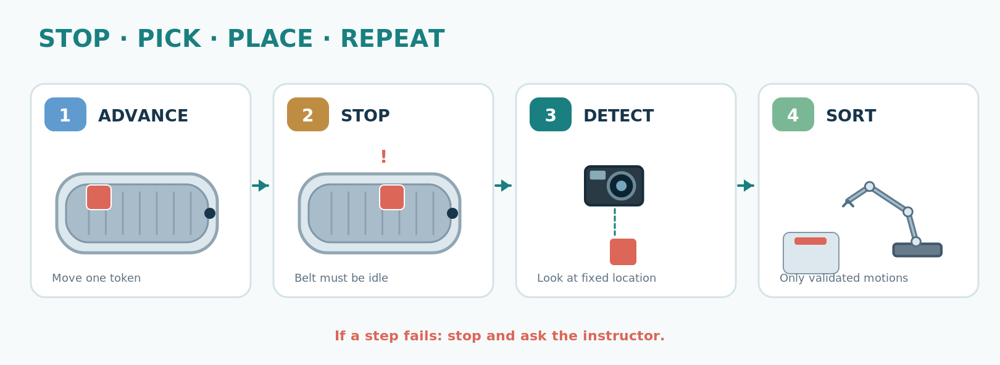

# Instructor setup, safety, and fallback

## Day-before setup (not during the student session)

- Prepare Python 3.11+ on three laptops and clone repo locally. Run `python -m workshop` offline on all three. Preinstall `.[camera]` only on the vision laptop; no package installation in class.
- Test neutral backdrop and red/blue 20–30 mm blocks with `tools/camera_probe.py`; photograph the pickup ROI and check thresholds on **real frames**, not only synthetic arrays.
- Secure EV3 belt, leader, follower, camera mount and deposit bins; tape down cables and keep out of children's reach. Use a mechanical guide to stop the block at a repeatable location.
- LeRobot: follow the official SO-101 [calibration and teleoperation guide](https://huggingface.co/docs/lerobot/en/so101) for the installed library revision. Identify actual `/dev/serial/by-id/` devices. Save positions/trajectories separately **after** supervising collision-free tests.
- EV3: determine installed firmware: `ev3dev2` over an isolated RPyC network, or another OS requiring a *different* driver. Do not change EV3 firmware on workshop day.
- Provide an emergency stop/access to power. Only instructor operates motors during validation. No automatic movement while someone is inside robot work envelope.
- Print worksheets, display slides, and keep five test objects and one known unknown object.

## Instructor arm setup (official LeRobot command, adjust real ports)

```bash
lerobot-calibrate --robot.type=so101_follower --robot.port=/dev/ttyACM0 --robot.id=workshop_follower
lerobot-calibrate --teleop.type=so101_leader --teleop.port=/dev/ttyACM1 --teleop.id=workshop_leader
lerobot-teleoperate --robot.type=so101_follower --robot.port=/dev/ttyACM0 --robot.id=workshop_follower --teleop.type=so101_leader --teleop.port=/dev/ttyACM1 --teleop.id=workshop_leader
```

**Not executed here.** These are documented CLI examples; serial ports differ. Install LeRobot separately via official instructions; it intentionally is **not** a required package for student laptops.

## EV3 guarded probe

For ev3dev Linux only, install `rpyc` on instructor PC; configure the EV3 `rpyc_classic.py` service on a **dedicated trusted network**. RPyC classic exposes remote code execution capabilities and must not be exposed to campus/public networks. After confirming belt direction and free movement, a short guarded probe is:

```bash
pip install -e '.[ev3]'
python tools/ev3_probe.py --host EV3_IP --i-understand-this-moves-hardware
```

**Unvalidated on physical hardware.** Motor port `outA` and brake behavior require confirmation. The script is for instructors only, not full automated conveyor control.

## Stop conditions and fallback

- A person enters work envelope → power off / stop actuators immediately.
- Camera is disconnected or detection unknown → no robotic pick, stop belt and inspect.
- EV3 timing does not reproducibly align object → run conveyor **manually**, do not chase moving parts.
- LeRobot missing calibration or collision-free replay → no arm actuation; demonstrate leader mechanically if safe and use `SimRobot`.
- GoPro stream does not work on Linux → switch to an available USB UVC camera or use `SimCamera`.
- Power/network/GPU unavailable → full workshop remains possible on Python standard library.

## Instructor schedule and hardware QA

See `docs/lesson-plan.md` and `docs/acceptance.md`. There is no unsupervised student access to physical actuator commands in this repo.


## Setup illustrations and references




For conceptual photographic visuals, see [the image gallery](visual-gallery.md). Images described as *AI-generated* are not photographs of the real laboratory; validate all hardware placement and safety constraints before student use.
