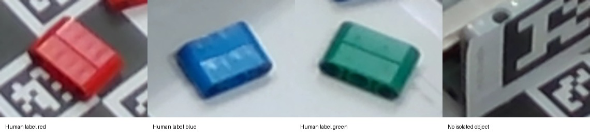

# Program your own sorting factory

22 October 2026 · First semester · Work in pairs

You will make a small program, use camera information to choose a destination, and test a simulated factory. No previous programming or robotics is needed. Your changes produce pictures immediately. These notebooks never control a physical machine.

One partner predicts, one types. Swap after each activity. There are no marks for speed.

## Start here

1. In the Jupyter file list open **Robot_Candy_Factory_Student.ipynb**. Choose **File → Save Notebook As** and give your copy your team name. Keep the original as a clean copy.
2. A **Markdown cell** contains explanation like this. A **code cell** contains instructions the computer can run. Click a code cell and press **Shift+Enter**: it runs and selects the next cell. Output appears underneath. A number in square brackets means the run finished; `[*]` means it is busy.
3. Run the short setup cell below once. Then read and run each cell in order. You can also click the triangular Run button.
4. Edit only the marked **STUDENT AREA** first. Click inside the code, change one value, run that cell again, and compare its output with your prediction. Each mission creates a fresh simulation when rerun.
5. Press **Ctrl+S** (Mac: **Command+S**) to save. A kernel is the Python process running your code. **Kernel → Restart Kernel** clears values held in memory; it does **not** undo edits saved in your file. To undo edits, use Undo or make a new copy of the original notebook. After restarting, run the setup cell again.

If you see an error, read its last line. Check paired quotes, commas, square brackets and spaces first. Worked error fix: `print("Hello factory)` is missing its closing quote. Python reports a SyntaxError on the last line. Repair it to `print("Hello factory")`, then rerun. After two attempts ask a partner or the instructor. If no picture appears, check that you ran the whole cell, then rerun setup. Do not install software during class.

```python
from pathlib import Path
import sys
root = Path.cwd()
if not (root / "workshop").is_dir():
    root = root.parent
if str(root) not in sys.path:
    sys.path.insert(0, str(root))
from exercises.student_visuals import draw_bins, show_photos, compare_observations
print("Ready. All activities are simulation only.")
```

## Before Python · Blockly logic · 10 minutes

Open [Blockly Maze](https://blockly.games/maze?lang=en). Drag instructions into a sequence, predict the route and run. Complete levels 1–3; levels 4–5 are optional. Explain one failed route and one correction. If internet fails, draw a maze and give your partner step instructions. Then return here. These web tasks do not control the physical station.

## A · Your first instructions · 30 minutes

A **program** is a sequence of instructions. `print` puts text in the **output**, the result below a code cell. A **string** is text inside quotes. Predict what will appear, then run this worked example with Shift+Enter.

```python
print("Hello factory")
```

### Your first edit

A **variable** is a name for a value. The single `=` stores text under the name `TEAM`. Run once. Then change only `"Team 1"` to your pair name, keeping both quotes, and rerun. Predict the changed words first. **Check:** the greeting should contain your new name. **Hint:** edit to the right of `=`.

```python
# STUDENT AREA: change the quoted name
TEAM = "Team 1"
print("Welcome to the robot factory,", TEAM)
```

### Repeat one instruction

A **loop** repeats its indented instruction. `range(REPEATS)` supplies that many numbers, starting at zero; `number + 1` displays numbering from one. The colon starts the group and four spaces put `print` inside it. Predict, run, then change only 3 to 5 and rerun. **Check:** the last object number matches REPEATS. **Hint:** numbers need no quotes.

```python
# STUDENT AREA: change the repeat count
REPEATS = 3
for number in range(REPEATS):
    print("Object number", number + 1)
```

### Choose a destination

A **condition** chooses an instruction. `==` asks whether two values match; `=` stores a value. `elif` tries another choice; `else` catches everything else. Predict the destination, run, then change only red to blue and rerun. Try yellow next. **Check:** one decision appears. **Hint:** preserve quotes and four spaces. The last line draws the result; keep it as provided.

```python
# STUDENT AREA: change the quoted color first
COLOR = "red"
if COLOR == "red":
    destination = "left"
elif COLOR == "blue":
    destination = "right"
else:
    destination = "reject"
print("Decision:", destination)
draw_bins([destination], [COLOR], "Your first decision")
```

### Explore with your partner

Try a new color of your choice. Predict before running; explain which condition matched. **Optional challenge:** add an `elif` for green before `else`, with an indented destination assignment. **Hint 1:** copy the shape of the blue branch. **Hint 2:** change its color and choose left or right. Keep the unknown fallback. Swap typing and predicting roles.

## B · Train a camera report · 20 minutes

A **sensor** measures something in the world. A camera is a sensor: it records an image, a grid of colored dots called pixels. A program may turn those pixels into a report such as `"red"`. A report can be wrong or missing.

First inspect these **real photograph crops** from our teaching station. The labels below are human descriptions of the visible examples. We are not claiming a live camera classifier measured these labels. The fourth crop does not isolate a colored object clearly. Which pixels would you trust?

Open [Teachable Machine](https://teachablemachine.withgoogle.com/train/image). Your instructor supplies prepared red, blue and background examples. Compare predictions on a held-out example; change the background or lighting and retry. A class name is a learned report, not truth. No export or live robot connection is needed. Use the controlled photograph/report experiment below if the website or camera is unavailable. Spend 5 minutes identifying classes, 7 testing examples, 5 changing one condition and 3 explaining a failure. Complete the website task OR the controlled photo/report fallback, not both. The five-report list and single-report cells below are optional extensions for challenges; finish this block after 20 minutes.

```python
show_photos()
```



### Ask for one report

The simulation supplies a report; it does not analyze the photo. `SimCamera` makes this practice sensor; `.detect()` requests its next report. Predict and run. Change red to blue and rerun. **Check:** the printed report changes. **Hint:** only edit the quoted word. This cell recreates the sensor each time.

```python
from workshop import SimCamera
# STUDENT AREA: change one report
camera = SimCamera(["red"])
print("Camera report:", camera.detect())
```

### Worked example and a list

A **list** stores several values in order. Square brackets start and end the list; commas separate its items: `["red", "blue", "unknown"]`. `None`, with no quotes, means a missing value; `"unknown"` is a text report that the color could not be decided.

Below `SimCamera` supplies the reports in `COLORS`; it does not analyze a photograph. `camera.detect()` asks this simulated sensor for its next report. The condition turns the report into a decision. The code below the STUDENT AREA is **provided plumbing**: run it but edit only COLORS and the two destination values first. `len` counts reports, `range` repeats once per report, and `routes.append` records an action for the picture. The program keeps **counts**, running totals for each destination. `+= 1` adds one to a total.

### Your turn

Point to each list item and predict left, right or reject. Run to check. Change the second report to red and run again. Add green at the end, including a comma before it. Then swap `RED_DESTINATION` and `BLUE_DESTINATION`. Rerun and describe the change.

**Small hint:** the names on the left of `=` stay the same; edit the quoted values on the right. **Check:** every report produces exactly one decision; unrecognized reports reach reject. **Optional challenge:** add a separate green condition before `else`; keep unknown and `None` rejected.

```python

from workshop import SimCamera

# ===== STUDENT AREA =====
COLORS = ["red", "blue", "unknown", "red", "blue"]
RED_DESTINATION = "left"
BLUE_DESTINATION = "right"
# ========================

camera = SimCamera(COLORS)
counts = {"left": 0, "right": 0, "reject": 0}
routes = []

for object_number in range(len(COLORS)):
    color = camera.detect()
    if color == "red":
        destination = RED_DESTINATION
    elif color == "blue":
        destination = BLUE_DESTINATION
    else:
        destination = "reject"  # never guess when a sensor is uncertain

    if destination not in ("left", "right", "reject"):
        destination = "reject"
    routes.append(destination)
    counts[destination] += 1
    print("Object", object_number + 1, "->", destination)

print("\nFinal counts:", counts)
print("Were any objects rejected? Why?")
draw_bins(routes, COLORS, "Decisions from the camera reports")
```

### Can correct code make a wrong decision

In this controlled example `ACTUAL` is our known object sequence; `REPORTS` is what we pretend the camera reports. The helper compares them and colors the bins using the **actual** objects. Thus a red object can visibly land in the wrong bin when its report is blue. These lists describe a teaching experiment, not measurements from the photo above.

Worked example: with matching lists the reports are correct. Run once. Then change **only the first report** to `"blue"`. Predict the destination of the actual red object and rerun. Next replace that report with `None`. Which experiment creates a wrong accepted sort and which creates a reject?

**Small hint:** keep both lists the same length. **Check:** the printed row shows actual color, report and destination for every object. **Optional challenge:** make two different errors; decide which ones the sorting rules can detect.

```python
# ===== STUDENT AREA =====
ACTUAL = ["red", "blue", "red", "blue"]
REPORTS = ["red", "blue", "red", "blue"]
# ========================
compare_observations(ACTUAL, REPORTS, {"red": "left", "blue": "right"})
```

## C · Visit three stations · 45 minutes

After the 85–95 minute break, save your work. Your instructor divides the class into three groups. Spend **15 minutes each** at robot and twin, camera and conveyor, and virtual robot, then rotate. The command-sequence activity below belongs to the virtual robot rotation; the separate live notebook belongs to robot and twin. Neither is an extra lesson. All three stations have an offline route.

**Robot and twin:** open Robot_Candy_Factory_Live_SO101.ipynb for the 15-minute read-only joint activity, in DEMO unless the instructor prepared LIVE. Return here afterward. An **actuator** makes a physical change. Motors turn joints and a gripper opens or closes. A destination like left is only a label. A real robot also needs **coordinates**, numbers describing a position relative to a chosen starting reference, and a safe movement sequence. Here we show destination commands only; these are not motor coordinates.

**Conveyor:** trace move → stop → observe → decide → pick. Use five paper objects and a finger as the belt if no live demonstration is available. One partner calls each step; the other acts. Deliberately call pick before stop once and explain why that order is unsafe.

**Virtual robot:** use the command-sequence activity below. Optional kinematics web app is in the instructor resources; offline sequences remain the core task. **Camera comparison:** compare the four photograph crops again. Describe one source of uncertainty. Cover part of a paper object or photograph and decide when a report should become unknown. Do not confuse seeing an object with knowing its exact position.

### Robot worked example

The list below is a **sequence**: commands happen in that order. `robot.sort(destination)` records one simulated placement. First predict left/right counts and run. Then change the sequence to left, left, right. Add reject. Finally try `"middle"`.

**Small hint:** keep square brackets and separate quoted commands with commas. **Check:** counts add up to the number of commands, including invalid commands sent to reject. **Optional challenge:** invent a six-command sequence; swap it with another pair and predict its totals before running.

```python

from workshop import SimRobot

# ===== STUDENT AREA =====
COMMANDS = ["left", "right", "left"]
# ========================

robot = SimRobot()
bin_counts = {"left": 0, "right": 0, "reject": 0}

for destination in COMMANDS:
    if destination not in ("left", "right", "reject"):
        print("Unknown destination - reject:", destination)
        destination = "reject"
    robot.sort(destination)
    bin_counts[destination] += 1

print("\nRobot commands:", robot.actions)
print("Objects per bin:", bin_counts)
print("Did the output match your prediction?")
draw_bins(robot.actions, title="Your robot command sequence")
```

## D · Connect the whole factory · 50 minutes

Now the program connects simulated belt, camera and robot. A factory cycle is one complete trip through move → stop → read → decide → sort. The provided `Factory` carries out this sequence. Every run below creates a new factory and resets its counts.

A **mapping** connects a key to a value. `RULES = {"red": "left", "blue": "right"}` means the report red maps to the destination left. Curly brackets hold the mapping; a colon connects each report to its destination; commas separate rules. The mapping is also called a dictionary in Python. It is useful because you can change a policy without rewriting the whole program.

### Worked example

For `OBJECTS = ["red", "blue"]` and the default rules, there is one left and one right. Trace each cycle with your partner before the larger example below.

### Your turn

Predict all five destinations and the totals on your worksheet. Run the original. Swap red/blue destinations, predict again, and rerun. Add an unknown report and verify it is rejected. Reorder the list and explain what changes in the action sequence and what stays the same in the totals.

**Small hint:** change the values in `RULES`, not the keys, to reverse destinations. **Check:** left + right + reject equals the list length; belt advances once per object. The log must show stop before camera read and robot placement. **Optional challenge:** add green to the object list and a green rule. Check a missing report with `None` too.

```python

from workshop import Factory, SimBelt, SimCamera, SimRobot

# ===== STUDENT AREA =====
OBJECTS = ["red", "blue", "red", "unknown", "blue"]
RULES = {"red": "left", "blue": "right"}
# ========================

factory = Factory(SimBelt(), SimCamera(OBJECTS), SimRobot())

for object_number in range(len(OBJECTS)):
    print("\n--- Object", object_number + 1, "---")
    factory.one_cycle(RULES)

print("\nFINAL FACTORY RESULT")
for destination, number in factory.counts.items():
    print(destination, ":", number)

print("Total objects:", sum(factory.counts.values()))
print("Belt advances:", factory.belt.steps)
print("Robot destinations:", factory.robot.actions)
assert sum(factory.counts.values()) == len(OBJECTS), "Some objects are missing!"
draw_bins(factory.robot.actions, OBJECTS, "Your completed sorting factory")
```

## E · Choose and test challenges · 35 minutes

Use the factory cell above. Choose two challenges with your partner. For each, write a prediction, change one thing, rerun, then record evidence. Return to the original five objects and rules before a new experiment so you know what caused the difference.

**1 · Flip the rules.** Make an unequal number of red and blue objects, then swap their destinations. Predict the changed totals. Hint: three reds and one blue make the swap visible. Check the action list as well as the totals.

**2 · Add green.** Add a green object first without a rule. Predict and run. Then add a rule and run again. Hint: a new entry in the mapping needs a comma. Check that unknown is still rejected.

**3 · Broken reports.** Add `None`, `"unknown"`, `42` and an empty string `""`. These stand for missing, undecidable, invalid and empty reports. Predict each route. Check that none is accepted as a known color. Hint: keep the original red/blue rules.

**4 · Count ten.** Create ten reports and count each destination by hand before running. Check totals and the printed order. Hint: repeats are allowed in a list.

**5 · Find a bad rule.** Temporarily change red to the destination `"middle"`. Predict what validation should do; run, then repair the rule. Hint: a destination must be left, right or reject. Check that the run finishes and every object is counted.

**6 · Challenge another pair.** Give them a short sequence with one missing report and tell them your rules. Let them predict before you run. Check both the per-object destinations and totals. Optional: write an `assert` after the factory cell to test one expected count. `assert` asks Python to stop with an error if a claim is false.

**Independent check:** a successful run alone does not prove that the rules are right. State one experiment that would reveal a rule error, and one real sensor problem these string reports cannot reproduce.

## Closing · 15 minutes

Save the notebook. Each pair shows one picture, one changed rule and one test result. Tell your partner which part senses, which part decides and which part acts. Explain why the belt stops before the robot picks.

On your worksheet finish: “Our prediction was …; the output showed …; we changed … because …”. Name one difference between this simulation and a real factory. A drawing or a command log does not prove that a real motor moved safely or a real object reached a bin.

You have written instructions, used observations to decide, and tested a small automated system.
