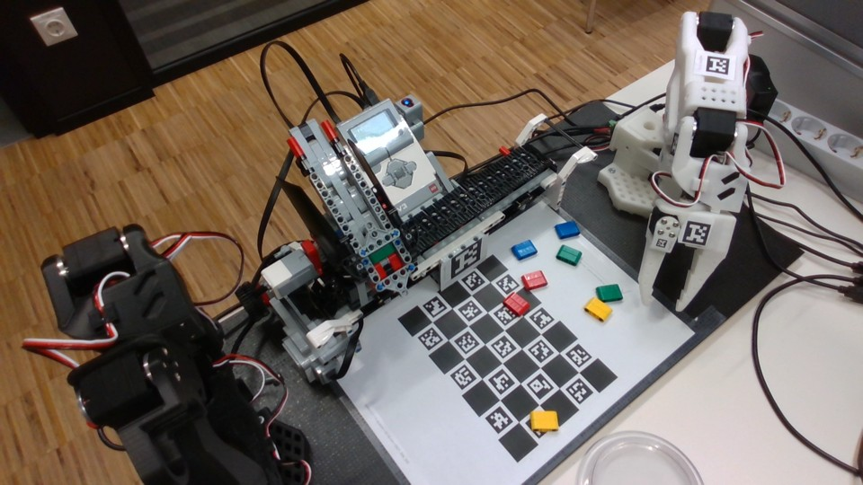

<!-- Generated from curriculum/workshop.json; edit the source, then run tools/build_notebooks.py. -->

# Your first robot factory

Build an offline robot factory from ordered instructions. Start with one fixed pickup fixture and one fixed destination. Pair roles: driver edits; observer predicts and checks; swap halfway. Only the instructor enables supervised hardware.

Simulation, paper, reports and measured physical outcomes are separate evidence. Never claim a grasp or placement from a command log alone. Unknown or stale observations require pause and inspection.

Save a pair copy. Run cells from the top with Shift+Enter. The essential route works offline. Read the explicit evidence and capture-mode labels below.

| Minutes | Duration | Session |
|---|---|---|
| 0-20 | 20 | Meet our factory |
| 20-45 | 25 | Ordered instructions |
| 45-65 | 20 | Observations and uncertainty |
| 65-95 | 30 | First Python edits |
| 95-105 | 10 | Break |
| 105-120 | 15 | Teach inspect and replay demonstration |
| 120-165 | 45 | Explore three stations |
| 165-210 | 45 | Build the physical sequence |
| 210-230 | 20 | Improve one failure |
| 230-240 | 10 | Three pair demonstrations |

```python
from pathlib import Path
import sys
root = Path.cwd()
if not (root / "workshop").is_dir():
    root = root.parent
if str(root) not in sys.path:
    sys.path.insert(0, str(root))
print("Offline learner simulation. No physical commands are sent.")

```



Actual supplied station photograph. It does not prove current commissioning or a successful pickup.

## Make a short conveyor story

Mission `blocks` · 25 minutes · Put instructions in order and repeat a small section.

**Worked example** Ready → dispense → belt to pickup endpoint → inspect. In simulation each command changes a model; no physical object is verified.

**Predict** Which message appears first? Where should the object model stop?

**Change** Change Ready to your pair name. Add repeat 2 around a message, then around one tested short sequence.

**Run** Open local Blockly simulation; select this mission; run the starter once. Use STOP and **Reset simulation** before a different test. Save your workspace.

**Observe** Read the command log and model state. Compare the repeated messages with your prediction.

**Explain** Why do instruction order and a stopped belt matter before pickup?

**Success check** Your pair can trace the order, predict a repeat count and explain one corrected sequence.

**Optional challenge** Try an intentionally wrong order in simulation and explain the result.

**Offline route** Draw each instruction on paper and move a paper object only when its instruction runs.

**Hint 1** Read from the top connection down.

**Hint 2** Repeat repeats every block inside it; start with a message.

```python
PROGRAM = [{"op": "log", "message": "Ready"},
           {"op": "ev3", "command": "eject"},
           {"op": "ev3", "command": "left_end"},
           {"op": "log", "message": "Inspect the stopped pickup fixture"}]
print("SIMULATION instructions; no hardware command sent")
for row in PROGRAM:
    print(row)

```

## Separate the object from its report

Mission `observe` · 20 minutes · Recognise missing and incorrect observations.

**Worked example** Use the human-labelled real photo collage notebooks/assets/photo-examples.jpg (also printed in the Student handbook under Separate the object from its report). Human labels describe visible objects. These reports are deliberately invented, not camera measurements. Row 1: actual red, report red. Row 2: actual blue, report None (missing). Row 3: actual red, report blue.


**Predict** Which of the three reports is missing? Which disagrees with the labelled object?

**Change** Change one report to None; then change one known report to a wrong known color.

**Run** Run the short Python example or trace these three rows on paper. Compare the human-labelled red/blue crops in notebooks/assets/photo-examples.jpg, also printed in the Student handbook under Separate the object from its report, with the invented reports.

**Observe** Record actual object, reported label and your decision separately. None means missing, never zero or proof of empty space.

**Explain** Why can a fresh color label still be wrong? What evidence would justify continuing?

**Success check** You identify one missing and one wrong report and choose pause/inspect for uncertainty.

**Optional challenge** Test unfamiliar green without adding a rule.

**Offline route** Paper pair: use the Student handbook's printed collage under Separate the object from its report, or open notebooks/assets/photo-examples.jpg from the learner ZIP. Use the three actual/report rows above and on your worksheet. These are human-visible labels with deliberately invented reports, not camera measurements.

**Hint 1** Compare actual and reported columns one row at a time.

**Hint 2** A known word is still only a report.

```python
ACTUAL = ["red", "blue", "red"]
REPORTED = ["red", None, "blue"]
for actual, report in zip(ACTUAL, REPORTED):
    print("Actual:", actual, "Reported:", report)
    print("Pause and inspect" if report is None else "Report needs checking")

```

## Change a name and a number

Mission `python` · 30 minutes · Read and edit a short Python program before sharing the same program representation with blocks.

**Worked example** TEAM stores text in quotes. REPEATS stores a number. print shows text. The indented line runs once for each number.

**Predict** What greeting and how many object lines will appear?

**Change** Change TEAM, predict, run. Then change REPEATS to 2, predict, run. Keep indentation.

**Run** Open the Student notebook, save a pair copy and run from the top with Shift+Enter. Run the shared Program example in simulation. In Blockly choose "Change a name and a number" before View executable Python.

**Observe** Count output lines. In Blockly choose "Change a name and a number", then **View executable Python**. Compare the command rows in its `program` list with `program.program` in the shared Python example: Ready, eject, left_end. JSON is text that stores the instruction list. **Save blocks** saves the workspace to reopen the editor; it is a different file. Simulation only.

**Explain** Which edit changed text? Which changed how often a line ran? What stayed in the same order?

**Success check** Both partners make one edit and explain it; shared commands are validated before execution.

**Optional challenge** Change a wait or message in both Python and Blockly and compare command traces.

**Offline route** Run exercises/01_python.py using the prepared Python or trace it on paper. No package downloads.

**Hint 1** Quotes surround text; do not quote the number.

**Hint 2** Four spaces keep print inside the loop.

```python
TEAM = "Team 1"
REPEATS = 3
print("Welcome to the robot factory,", TEAM)
for number in range(REPEATS):
    print("Object number", number + 1)

```

```python
from workshop.blockly_client import Program, simulate_program
program = Program().log("Ready").ev3("eject").ev3("left_end")
result = simulate_program(program)
print("SIMULATION only:", result["complete"])
print(result["events"])
print("Shared Blockly JSON:", program.program)

```

On the prepared shared station, the instructor can submit the same `program` with `run_program(program, physical=False)` from `workshop.blockly_client`. That explicit simulation endpoint must already be running. The executable cell above uses the same validator and interpreter locally. Physical submission requires the supervised prepared station and its admission checks.

## Watch teach inspect return replay

Mission `teach-demo` · 15 minutes · Understand one saved movement (a stroke) and its required start/end arm arrangement (pose), gripper opening (jaw state) and measured references (calibration).

**Worked example** A stroke is one saved movement. A pose is the arm arrangement at start/end. Jaw state means gripper opening. Calibration means the measured references a recording assumes. Metadata means recording details. Relative follows the change from each arm's starting angle: leader starts at 10°, follower at 30°, leader now 15°, so follower requests 30 + (15 - 10) = 35°. Absolute uses the leader's calibrated angle, 15°. These are invented DEMO angles. A request and a measured result are different.

**Predict** Will a replay start safely from any pose? What if the jaw state changed?

**Change** Ask the instructor to change one invented angle; predict before rerunning. Learners do not change physical modes.

**Run** Watch instructor: teach a short empty stroke, stop recording, inspect recording details and path, return safely to its validated start, then replay separately.

**Observe** Name start pose, endpoint, jaw state, identity/calibration and validity evidence. An invented demo recording is never a student-taught physical skill.

**Explain** Why must teaching and playback be separate runs? Why does a changed robot or calibration require reteaching?

**Success check** You can say teach → inspect/validate → return to start → replay, and point to STOP.

**Optional challenge** Predict a relative versus absolute joint request.

**Offline route** Use the invented joint example and paper start/end diagrams. Label evidence DEMO.

**Hint 1** A recording stores movement; it does not plan a safe approach from every pose.

**Hint 2** A screen model can match commands while a physical object slips.

```python
LEADER_START = 10
FOLLOWER_START = 30
LEADER_NOW = 15
print("DEMO: invented angles; no robot measurement")
print("Relative prediction:", FOLLOWER_START + LEADER_NOW - LEADER_START, "degrees")
print("Absolute prediction:", LEADER_NOW, "degrees")

```

## Explore three stations

Mission `explore` · 45 minutes · Connect observations, instructions and the robot model.

**Worked example** Completed SIMULATION sample using the earlier invented joint calculation: our prediction was 35° relative. We changed LEADER_NOW from 10° to 15°, keeping LEADER_START = 10° and FOLLOWER_START = 30°. The model calculation 30 + 15 - 10 printed 35° relative and 15° absolute. This is arithmetic, not a measured physical joint or evidence of safe motion. For arm observation use the existing Teach demo example (Watch teach inspect return replay) and Live notebook. For conveyor reports use the Observe and decide example (Separate the object from its report). For offline preparation use the shared Program example under Change a name and a number.

**Predict** At your current station, predict one direction, report or sequence before the instructor or simulator acts.

**Change** Change only one paper angle, report or message; switch driver and observer halfway.

**Run** Each slot is 15 minutes: 2 predict, 7 change/run, 4 observe/explain, 2 save and transition. Use the rotation table.

**Observe** Arm: compare measured joint and twin when available. Conveyor: inspect stopped fixture/report. Offline: compare ordered traces. Label each evidence source.

**Explain** Which part measures, decides or acts? What can your evidence establish?

**Success check** Every pair completes all three positions with one recorded prediction and evidence statement per position.

**Optional challenge** Compare a fresh report with a stale one without guessing missing values.

**Offline route** All three positions have photo, paper and simulation versions; record DEMO/OFFLINE if no measured stream.

**Hint 1** The twin is a model updated from a stream.

**Hint 2** Use the same short sequence at the offline table.

## Dispense carry pick and place

Mission `integrate` · 45 minutes · Assemble the supervised fixed pickup to fixed destination sequence.

**Worked example** EV3 dispense → conveyor to pickup fixture and stop → named taught skill fixed_pick_place. That skill binds validated approach/open, calibrated grasp, lift/transfer, release and return phases. Missing or uncommissioned qualification blocks physical execution; simulation labels every transfer synthetic.

**Predict** Where must the object and arm be before each next step? What should stop the run?

**Change** First reorder paper cards. In simulation use pick_place_recording named fixed_pick_place and change one message or delay. Physical execution requires instructor-validated phase recordings, measured jaw calibration and the qualification manifest; missing evidence is a blocking result.

**Run** Rotate: supervised integration, offline trace/rehearsal, failure/evidence desk. Each 15-minute slot includes 2 minutes transition. Run dispense, conveyor/stop and the named fixed_pick_place skill only through the existing shared endpoint. Instructor alone enables a qualified physical run; otherwise complete explicit synthetic simulation.

**Observe** Record dispense, stopped fixture arrival, grasp, lift, placement/release and return separately. A completed command does not prove object transfer.

**Explain** Which observation supports each claimed step? Which step remains unverified?

**Success check** Your pair explains the full fixed-fixture sequence and records honest per-step evidence. Physical completion requires observed object transfer; offline completion is labelled rehearsal.

**Optional challenge** After the core succeeds, discuss color-dependent destinations as separately validated taught skills.

**Offline route** Use the same fixed pickup/drop paper layout and named-skill simulation. Its grasp/lift/release outcomes are synthetic assumptions with physical_evidence false. Missing recordings or qualification means physical execution remains incomplete.

**Hint 1** Stop the conveyor before the arm approaches.

**Hint 2** Start/end poses and jaw state of adjacent taught strokes must agree.

```python
from workshop.blockly_client import Program, simulate_program
program = (Program().ev3("eject").ev3("left_end")
           .pick_place_recording("fixed_pick_place", .5))
result = simulate_program(program)
skill = result["taught_skills"][0]
print("Synthetic fixed-fixture rehearsal:", skill["state"])
print("Physical evidence:", skill["physical_evidence"])
assert skill["physical_evidence"] is False
assert not any(skill[k] for k in ("pickup_verified", "lift_verified", "release_verified"))

```

## Find one failure and test a repair

Mission `improve` · 20 minutes · Use a controlled change and evidence to improve a sequence.

**Worked example** A missing fixture observation pauses the sequence after one inspected object. Fix the observation path before retrying.

**Predict** What happens when the middle report is None?

**Change** Test one failure: missing report, wrong order, missing recording or STOP. Change one cause only and reset.

**Run** Reproduce in simulation or paper; record expected versus actual. Repair and rerun the same input.

**Observe** Capture the failure message, stopped state and repaired trace. No physical fault injection by learners.

**Explain** Did your test detect the problem? What could still fail on hardware?

**Success check** You show a failing prediction, one repair and a repeated check with its limits.

**Optional challenge** Use the optional color-routing example with three reds and one blue to expose swapped rules.

**Offline route** All failures can be traced with paper command/report cards.

**Hint 1** Choose one input so cause and effect stay clear.

**Hint 2** A successful run alone cannot identify a wrong known report.

```python
REPORTS = ["present", None, "present"]
completed = 0
for report in REPORTS:
    if report is None:
        print("STOP: missing observation; inspect before retry")
        break
    completed += 1
print("Simulated inspected objects:", completed)

```

## Show one prediction and result

Mission `share` · 10 minutes · Explain what your program did and what the evidence cannot prove.

**Worked example** Completed SIMULATION sample from the earlier Blockly message exercise: we predicted Ready would appear twice. We changed the repeat count from 1 to 2 around the Ready message. The simulated command log showed Ready twice. This checks message repetition only; it does not prove physical conveyor arrival or a grasp.

**Predict** Which single output best supports your claim?

**Change** Shorten your demonstration to one change and one observation.

**Run** Use 1 minute preparation, 3 demonstrations of 2 minutes, 3 minutes shared reflection. Both partners speak.

**Observe** Show saved trace, worksheet or observed supervised step; label simulation, paper or physical.

**Explain** Name one next test that would increase confidence.

**Success check** All three pairs demonstrate and state a specific limitation.

**Optional challenge** Explain how a wrong known color differs from a missing report.

**Offline route** Present the worksheet and paper trace.

**Hint 1** Read your prediction before the result.

**Hint 2** A trace supports instruction order, not physical arrival.

## Pair rotations

Each 15-minute slot includes 2 minutes to save and transition. Driver edits; observer predicts and checks. Swap roles halfway. One instructor controls the physical integration station.

### Explore three stations

| Slot | Pair A | Pair B | Pair C |
|---|---|---|---|
| 1 | Arm and twin observation | Conveyor and observation sequencing | Offline Blockly and Python preparation |
| 2 | Conveyor and observation sequencing | Offline Blockly and Python preparation | Arm and twin observation |
| 3 | Offline Blockly and Python preparation | Arm and twin observation | Conveyor and observation sequencing |

### Build the physical sequence

| Slot | Pair A | Pair B | Pair C |
|---|---|---|---|
| 1 | Supervised fixed-fixture integration | Offline sequence rehearsal | Failure tests and evidence |
| 2 | Offline sequence rehearsal | Failure tests and evidence | Supervised fixed-fixture integration |
| 3 | Failure tests and evidence | Supervised fixed-fixture integration | Offline sequence rehearsal |

## Optional color destinations extension

Complete the fixed-fixture core first. This separate simulated routing example does not teach physical grasping. Predict each route. Change an input, run, observe routes and counts, and explain a limitation. Try three reds and one blue before swapping rules. Unknown or invalid reports reject.

```python
from workshop import Factory, SimBelt, SimCamera, SimRobot
OBJECTS = ["red", "blue", "red", "unknown", "blue"]
RULES = {"red": "left", "blue": "right"}
factory = Factory(SimBelt(), SimCamera(OBJECTS), SimRobot())
for _ in OBJECTS:
    factory.one_cycle(RULES)
print(factory.counts)
print("SIMULATION routes:", factory.robot.actions)
assert sum(factory.counts.values()) == len(OBJECTS)

for destination, count in factory.counts.items():
    print(destination, ":", count)
print("Total objects:", sum(factory.counts.values()))

```
