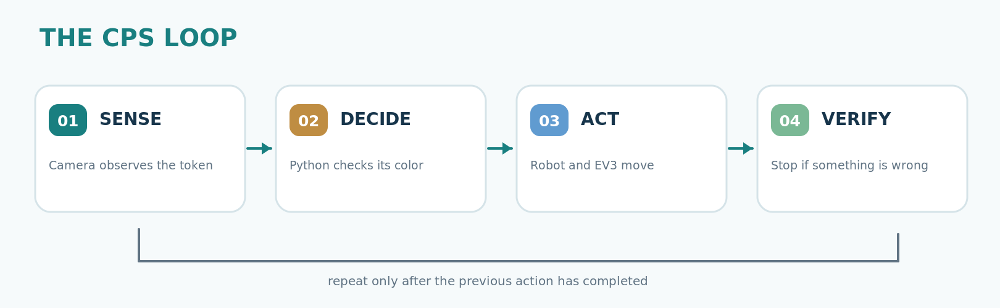
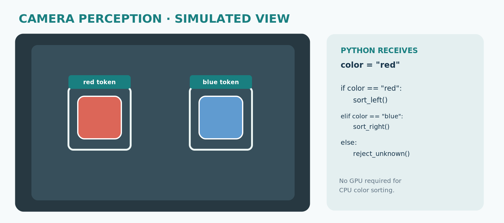
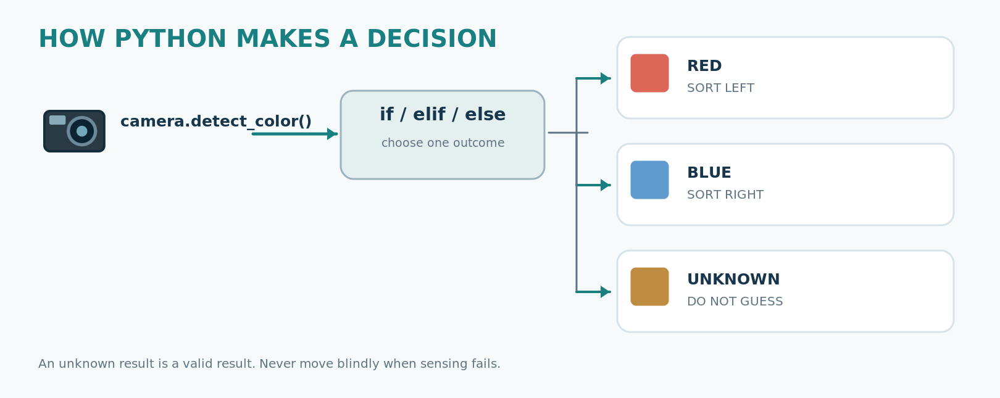

# Student worksheet | CPS Candy Factory

**Team:** _________    **Participants:** ______________________

## Mission

Make a small factory sort red and blue objects. A sensor reports information, Python decides where to send the object, and an actuator moves it. Unknown objects must be rejected rather than guessed.

### Station 1 — Your first Python program

1. Run `python exercises/01_python.py`.
2. Make it print your team's name, five times.
3. Explain what `range(3)` does. **Our answer:** ____________________

### Station 2 — Robot

1. Follow the safety instructions before anyone touches the leader or follower.
2. Watch the instructor demonstrate a grasp and placement.
3. Run `python exercises/02_robot.py`, change the destination order and explain the log.

### Station 3 — Vision

1. Run `python exercises/03_vision.py`.
2. Change the order of colors in the sample data.
3. What should happen if the camera cannot classify an object? _____________

### Factory challenge

1. Run `python exercises/04_sort.py`.
2. Change the rule so **blue goes left** and **red goes right**.
3. Run five cycles. **Left:** ____ **Right:** ____ **Rejected:** ____
4. Test one unknown object. Does it reach a sorting bin? ______

### Bonus (only if instructor confirms camera is ready)

Try `python -m workshop --camera 0 --cycles 3` after the instructor checks the camera number. Compare simulated vs physical visual information. Arm and belt remain simulated in this command.

### CPS reflection

- **Sensor:** __________________
- **Decision:** __________________
- **Actuator:** __________________
- **Possible failure:** __________________
- **How to handle it:** __________________

**Key point:** the robot can only act reliably when we know what we sensed, where it is, and what to do if information is missing.
