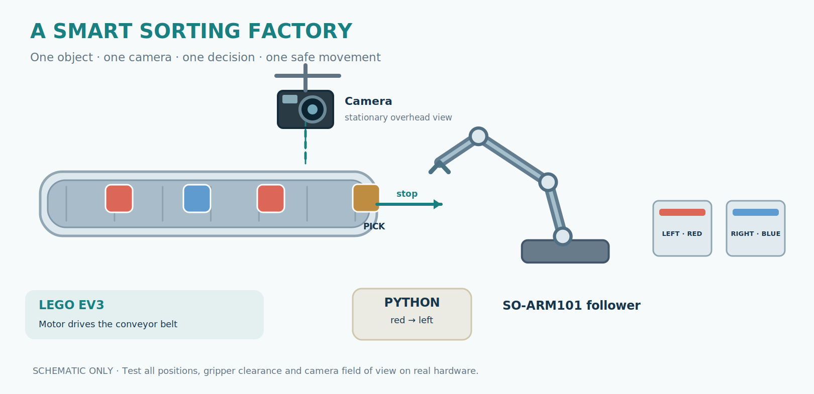
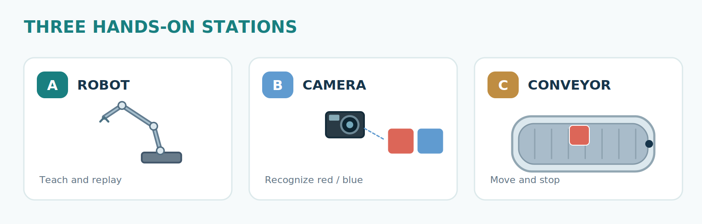
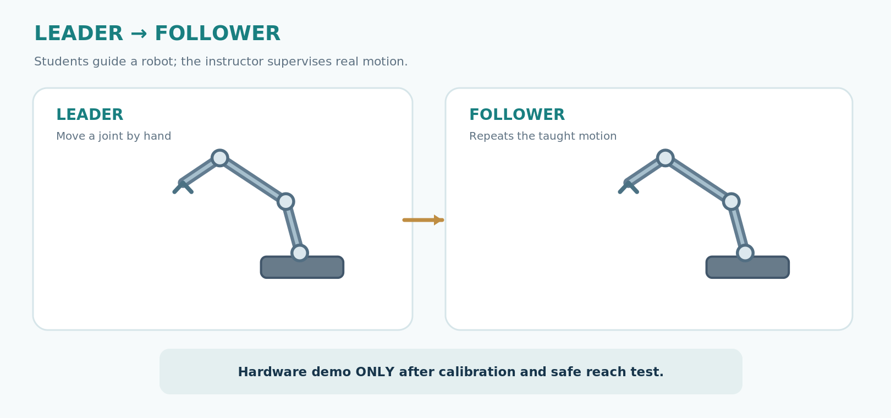
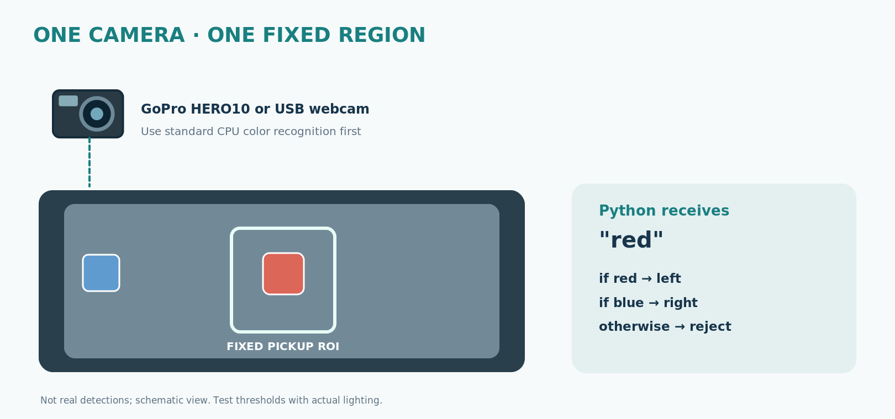
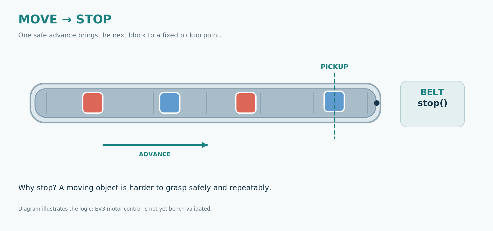
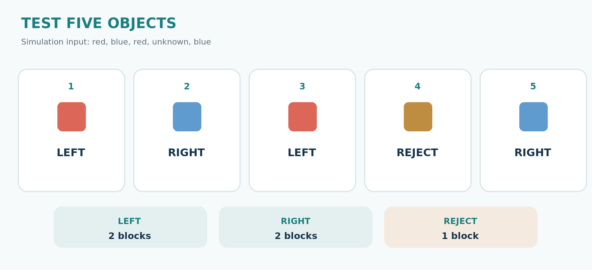
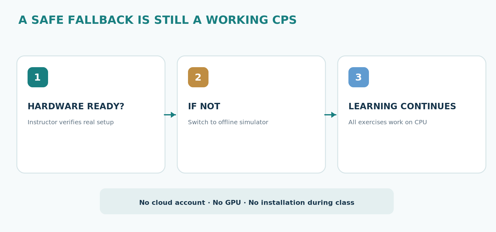
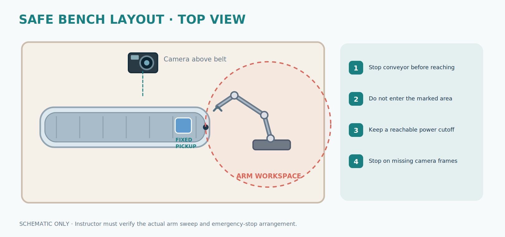

# Visual gallery · CPS Candy Factory

Historical record from 12 October 2026, archived on 21 October. Statements about “current” materials below describe that earlier version. See the [archive guide](../README.md) for current replacements.

The current classroom presentation and handouts use a **single consistent graphic language** (navy/teal/blue/red, flat schematic illustrations). They are SVG sources with PNG renditions; the diagram elements are editable in the SVG source. They are conceptual and not hardware validation evidence.

## Physical layout

## Sensing → decision → action

## Three teaching stations

## Reliable integration

## Original AI concept images (archive, not used in teaching slides)

Older image-generated composite posters and crops remain available under `assets/sources/` and `assets/archive/scene-*.jpg`. They are visibly inconsistent (arm appearance and unvalidated hardware details) and are deliberately excluded from the student-facing PowerPoint/DOCX materials. Do not present them as photos of the university lab.

See [image provenance](assets/README.md) and [revision and QA notes](revision-report.md).
